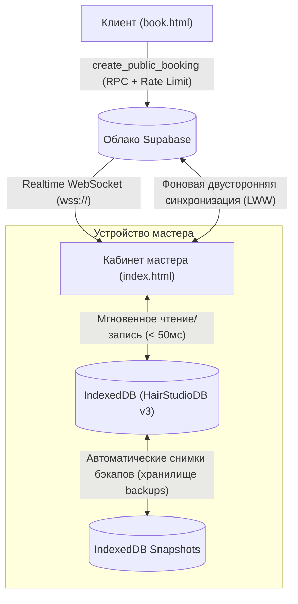

# ✂️ Sheber — PWA-система онлайн-записи и CRM-учета для бьюти-мастеров и салонов

[](manifest.json)
[](js/db.js)
[](migration_security_rls.sql)
[](index.html)

**Sheber** (каз. *Шебер* — мастер своего дела, умелец) — современное, ультрабыстрое мобильно-ориентированное веб-приложение (**Progressive Web Application**) с архитектурой **Offline-First**. Создано для частных мастеров индустрии красоты (парикмахеров, барберов, колористов, мастеров маникюра, бровистов, лешмейкеров, косметологов) и студий.

Приложение объединяет в одном интерфейсе расписание, CRM клиентов с формулами и историей визитов, учет расходов, аналитику чистой прибыли, а также персональную веб-страницу онлайн-записи с автоматическим контролем пересечения времени, защитой от спама и интеграцией с **2ГИС**, **WhatsApp** и **Kaspi**.

---

## ✨ Ключевые возможности

* 📱 **Полноценное PWA (Offline-First)**: Устанавливается как нативное приложение на iOS и Android. Работает со скоростью отклика **< 50 мс** через локальную базу **IndexedDB** даже при полном отсутствии интернета.
* ⚡ **Supabase Realtime**: Мгновенное поступление входящих онлайн-заявок через WebSocket без задержек и без постоянных опросов сервера (polling).
* 📅 **Умное расписание**: Интерактивный таймлайн рабочего дня, гибкая сетка слотов (15/30/60 мин), настройка рабочих часов мастера и мгновенная проверка коллизий.
* 👥 **Клиентская база & CRM**: Карточки клиентов, история посещений, формулы окрашивания и персональные заметки. Облачная синхронизация между устройствами мастера.
* 💰 **Финансы и аналитика**: Раздельный учет выручки и расходов на материалы, расчет чистой прибыли, маржинальности и рейтинга самых доходных услуг.
* 🌐 **Персональная онлайн-запись (`book.html?m=slug`)**: Ссылка для соцсетей (Instagram, TikTok) и мессенджеров (WhatsApp). Клиенты выбирают услуги и свободные окна без необходимости звонить или писать мастеру.
* 🗺️ **Интеграция с 2ГИС & WhatsApp**: Автоматическое построение маршрута до салона в приложении 2ГИС по ссылке мастера и переход в WhatsApp-диалог в один клик.
* 🛡️ **Комплексная безопасность**: Строгий Row Level Security (RLS) в PostgreSQL, защита от XSS, скрытие персональных данных клиентов (PII) от публичного доступа и встроенный **Rate-Limiting / Anti-Spam**.
* 💳 **Система тарифов и Kaspi QR**: Поддержка пробного периода, подписок (1/6/12 месяцев, бессрочно) и удобной оплаты переводом Kaspi.
* 👑 **Панель суперадминистратора (`admin.html`)**: Централизованное управление мастерами, продление тарифов, аудит платежей и мониторинг активности платформы.
* 💾 **Многоуровневый бэкап**: Автоматические снимки базы данных сохраняются в изолированное хранилище IndexedDB (без лимита 5 МБ в `localStorage`) с возможностью ручного экспорта/импорта в `.json`.

---

## 🏗️ Архитектура и стек технологий

| Компонент | Технология | Описание |
| :--- | :--- | :--- |
| **Frontend** | Vanilla JavaScript (ES Modules), HTML5, CSS3 | Без тяжелых фреймворков. Нативный запуск модулей браузером через `<script type="module">`. |
| **Сборка** | **No-build / Zero-bundler** | Отсутствуют зависимости от `node_modules`, Webpack, Vite или npm. Проект готов к работе сразу после клонирования. |
| **Дизайн-система** | Custom Vanilla CSS + Glassmorphism | Темная тема `#0a0e17` с золотисто-янтарными акцентами (`#d4af37`), оптимизированная под сенсорные экраны смартфонов. |
| **Локальная БД** | [IndexedDB](js/db.js) (`HairStudioDB` v3) | Хранилища: `appointments`, `services`, `expenses`, `clients`, `client_notes`, `backups`. Диапазонные выборки по `IDBKeyRange`. |
| **Облачный бэкенд** | [Supabase](js/supabase-sync.js) | PostgreSQL 15+, GoTrue Auth, Realtime WebSocket Channels, Row Level Security и функции `SECURITY DEFINER`. |
| **PWA & Кэш** | [Service Worker](sw.js) (`sheber-cache-v36`) | Стратегия **Network-First** с автоматическим fallback в оффлайн-кэш для всех статических ассетов. |
| **Локальный сервер** | [Python 3](serve.py) (`serve.py`) | Встроенный HTTP-сервер на порту **8080** с белым списком расширений и блокировкой доступа к скрытым файлам. |

---

## 🗄️ Структура проекта

```text
sheber-app/
├── index.html                   # Рабочий кабинет мастера (расписание, CRM клиентов, услуги, финансы)
├── book.html                    # Публичная страница онлайн-записи клиента (?m=slug)
├── admin.html                   # Панель управления суперадминистратора платформы
├── serve.py                     # Безопасный сервер разработки на Python 3 (порт 8080)
├── sw.js                        # Service Worker (PWA-кэш v36, оффлайн-режим)
├── manifest.json                # Манифест PWA (установка на экран смартфона)
├── jsconfig.json                # Конфигурация ES-модулей для IDE
├── LICENSE                      # Лицензия MIT
│
├── css/
│   ├── style.css                # Основные стили кабинета (темная палитра, адаптивная верстка)
│   ├── book.css                 # Стили публичной страницы онлайн-записи
│   └── admin.css                # Стили панели суперадминистратора
│
├── js/
│   ├── app.js                   # Точка входа: роутинг, модальные окна, Realtime-подписка, бэкапы
│   ├── state.js                 # Реактивное состояние и O(1) Map-индексы
│   ├── utils.js                 # Форматирование дат/валюты, escapeHtml, нормализация телефонов
│   ├── calendar.js              # Календарь, таймлайн, карточки записей, проверка коллизий
│   ├── clients.js               # База CRM: карточки клиентов, формулы окрашивания, история
│   ├── services.js              # Каталог услуг мастера, длительность, категории
│   ├── finance.js               # Учет расходов, чистая прибыль, маржинальность, топ-услуги
│   ├── subscription.js          # Тарифные планы, проверка статуса, реквизиты Kaspi QR
│   ├── book.js                  # Контроллер клиентского бронирования и выбора слотов
│   ├── admin.js                 # Контроллер панели суперадминистратора
│   ├── db.js                    # Обертка IndexedDB (HairStudioDB v3, хранилища, снимки бэкапов)
│   └── supabase-sync.js         # API-клиент Supabase (Auth, Realtime, RPC, облачная CRM)
│
├── icons/
│   ├── icon-192.png             # Иконка PWA 192x192
│   ├── icon-512.png             # Иконка PWA 512x512
│   └── icon-512.jpg             # Мастер-логотип Sheber
│
└── SQL Migrations (Supabase):
    ├── supabase_schema.sql             # 1. Базовая каноническая схема PostgreSQL v2.0
    ├── migration_subscriptions.sql     # 2. Подписки мастеров, Kaspi-платежи и гео-ссылка 2ГИС
    ├── migration_security_rls.sql      # 3. Row Level Security, защита ПДн, триггеры коллизий и RPC
    ├── migration_cloud_crm.sql         # 4. Облачная CRM (клиенты, визиты, расходы) с изоляцией RLS
    └── migration_load_optimization.sql # 5. Оптимизация на 50 000+ записей, Rate-Limiting и Realtime
```

---

## 🚀 Быстрый старт и локальный запуск

Для запуска не нужны `Node.js` или `npm` — достаточно установленного **Python 3**.

### 1. Запуск на локальном компьютере:
```bash
python serve.py
```
После запуска браузер автоматически откроет: **http://localhost:8080**

### 2. Запуск для проверки на смартфоне (в локальной сети Wi-Fi):
```bash
python serve.py --lan
```
Сервер определит IP-адрес вашего компьютера в локальной сети и выведет ссылку (например, `http://192.168.1.50:8080`).

> [!TIP]
> **Как установить PWA на телефон**:
> * **iPhone (Safari)**: Откройте ссылку мастера -> нажмите иконку **«Поделиться»** -> выберите **«На экран "Домой"»**.
> * **Android (Chrome)**: Откройте ссылку мастера -> нажмите **«Меню (три точки)»** -> выберите **«Установить приложение»**.

---

## ☁️ Развертывание и настройка базы данных Supabase

Для включения облачной синхронизации, авторизации мастеров и онлайн-записи используйте личный кабинет [Supabase Dashboard](https://supabase.com).

### Шаг 1: Создание проекта Supabase
1. Создайте новый проект в [Supabase](https://supabase.com).
2. Перейдите в **Project Settings -> API** и скопируйте:
   * **Project URL**
   * **Project API Anon Key**
3. Укажите скопированные ключи в объекте `DEFAULT_SUPABASE_URL` и `DEFAULT_SUPABASE_KEY` в файле [js/supabase-sync.js](js/supabase-sync.js) (или задайте их через настройки кабинета мастера).

### Шаг 2: Применение SQL-миграций
Откройте вкладку **SQL Editor** в консоли Supabase и поочередно выполните скрипты **строго в следующем порядке**:

1. 📄 **[supabase_schema.sql](supabase_schema.sql)** — *Каноническая схема платформы*:
   * Создает таблицы `masters` (включая город `city`, адрес, Instagram, рабочий график), `master_services`, `master_busy_slots`, `booking_requests`.
   * Настраивает внешние ключи к `auth.users(id)` и базовую изоляцию данных.
2. 📄 **[migration_subscriptions.sql](migration_subscriptions.sql)** — *Система тарифов и гео-данных*:
   * Добавляет статус подписки (`trial`, `active`, `lifetime`), сроки действия, ссылку на 2ГИС (`gis_url`), флаг администратора `is_admin`.
   * Создает таблицу учета платежей `subscription_payments`.
3. 📄 **[migration_security_rls.sql](migration_security_rls.sql)** — *Защита данных и безопасные RPC*:
   * Включает RLS для всех ключевых таблиц.
   * Устанавливает триггер `protect_master_sensitive_fields` (блокирует подделку статуса подписки мастером).
   * Добавляет триггер `check_booking_collision` против наложения записей.
   * Создает защищенную функцию `get_occupied_slots` (клиенты видят только занятые интервалы без доступа к телефонам и именам).
4. 📄 **[migration_cloud_crm.sql](migration_cloud_crm.sql)** — *Облачная синхронизация CRM мастеров*:
   * Создает облачные таблицы `master_clients`, `master_appointments`, `master_expenses`.
   * Настраивает персональные политики RLS: каждый мастер видит и редактирует исключительно свои записи.
5. 📄 **[migration_load_optimization.sql](migration_load_optimization.sql)** — *Высокая нагрузка и Realtime*:
   * Включает таблицу `booking_requests` в публикацию **Supabase Realtime** (`supabase_realtime`).
   * Внедряет **Anti-Spam Rate-Limiting** в RPC `create_public_booking` (не более 4 заявок с одного номера за час, блокировка прошлых дат и записей глубже 90 дней).
   * Создает составные высокоскоростные B-Tree индексы для мгновенной выборки на объемах 50 000+ записей.

### Шаг 3: Назначение первого суперадминистратора
В **SQL Editor** Supabase выполните запрос для активации прав администратора:

```sql
-- Способ 1: По короткой ссылке (slug) мастера:
UPDATE public.masters 
SET is_admin = true, 
    subscription_status = 'lifetime',
    subscription_plan = 'lifetime',
    subscription_ends_at = timezone('utc'::text, now()) + interval '100 years'
WHERE slug = 'rustem'; -- укажите slug вашего мастера

-- Способ 2: По email зарегистрированного пользователя в Supabase Auth:
UPDATE public.masters 
SET is_admin = true, 
    subscription_status = 'lifetime',
    subscription_plan = 'lifetime',
    subscription_ends_at = timezone('utc'::text, now()) + interval '100 years'
WHERE user_id = (SELECT id FROM auth.users WHERE email = 'admin@sheberapp.kz' LIMIT 1);
```

После этого данный аккаунт сможет входить в защищенную панель [admin.html](admin.html).

---

## 🔒 Безопасность и архитектурные принципы

> [!IMPORTANT]
> Безопасность платформы построена на принципе нулевого доверия к клиентским данным (**Zero Trust Client Model**).

* **Защита от XSS (Cross-Site Scripting)**: Все пользовательские строки перед вставкой в DOM экранируются утилитой `escapeHtml()` в [js/utils.js](js/utils.js). На страницах настроена строгая директива `Content-Security-Policy`.
* **Защита персональных данных (PII)**: На странице онлайн-записи [book.html](book.html) прямой доступ к таблицам базы закрыт. Клиентский интерфейс запрашивает исключительно обезличенные интервалы занятости через защищенный RPC `get_occupied_slots`.
* **Защита от подделки тарифов**: Поля `is_admin`, `subscription_status` и `subscription_ends_at` контролируются серверным триггером `protect_master_sensitive_fields` и могут изменяться только владельцем сервиса через сервисный ключ или защищенный RPC.
* **Целостность цен и расписания**: При подтверждении онлайн-заявки сопоставление выбранных услуг и расчет стоимости производятся на стороне мастера по его актуальному каталогу.
* **Безопасность сервера разработки**: [serve.py](serve.py) фильтрует входящие запросы по белому списку расширений и пресекает доступ к системным директориям (`.git`, `.env`, `.sql`, `.py`).

---

## 📊 Модель синхронизации данных (Hybrid Offline-First)



1. **Мгновенный локальный отклик**: Все действия мастера (добавление записи, редактирование клиента, внесение расхода) немедленно фиксируются в IndexedDB.
2. **Фоновая репликация**: При наличии интернет-соединения изменения отправляются в облачные таблицы `master_clients`, `master_appointments`, `master_expenses`.
3. **Разрешение конфликтов (LWW)**: Применяется стратегия **Last-Write-Wins** с приоритетом входящих клиентских бронирований, что исключает потерю новых заявок при работе оффлайн.
4. **Смена устройства**: При авторизации на новом смартфоне мастер может в 1 клик восстановить все данные из облака Supabase.

---

## 📄 Лицензия

Проект распространяется для внутреннего и коммерческого использования под лицензией **MIT**. Разработано с фокусом на надежность, скорость и удобство мастеров.
